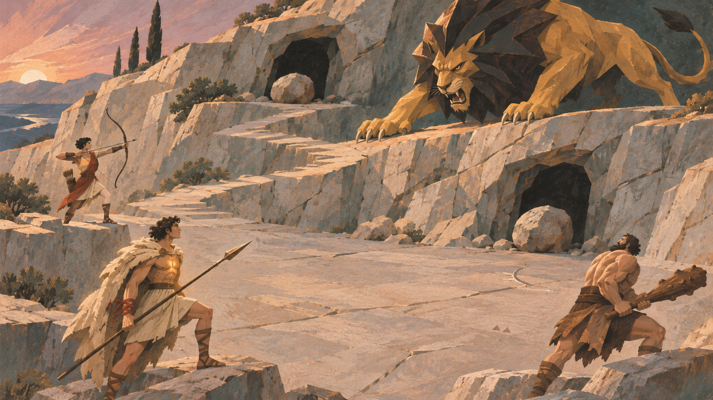
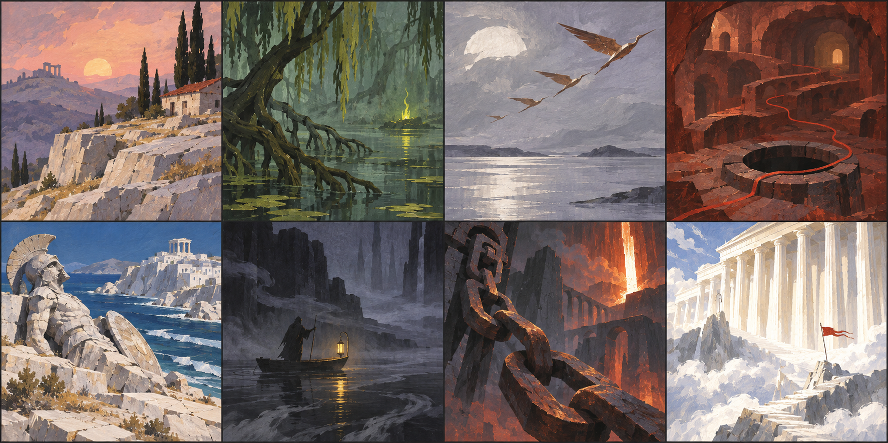
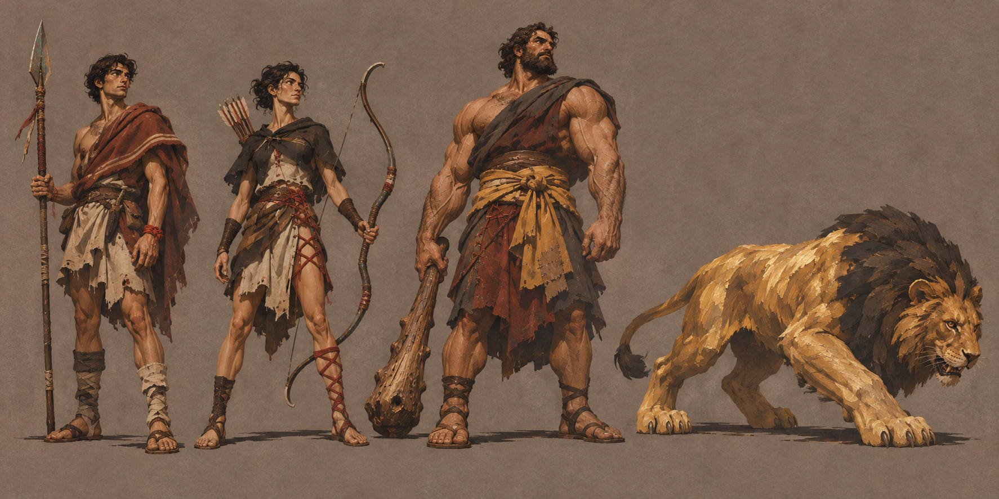
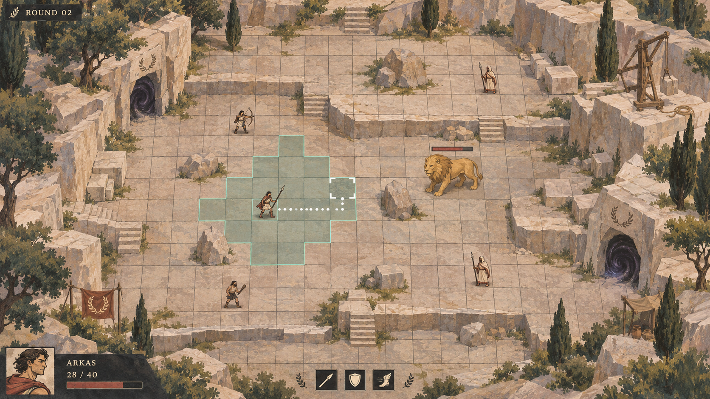
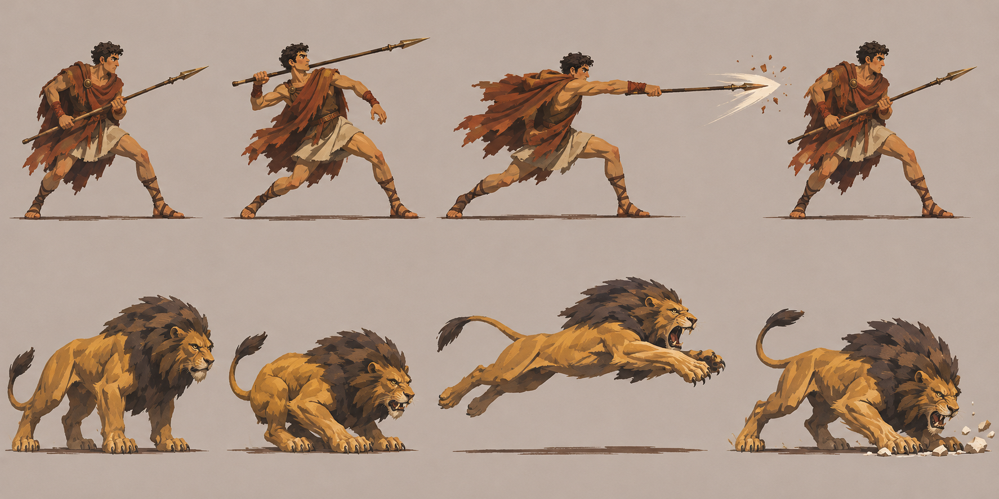
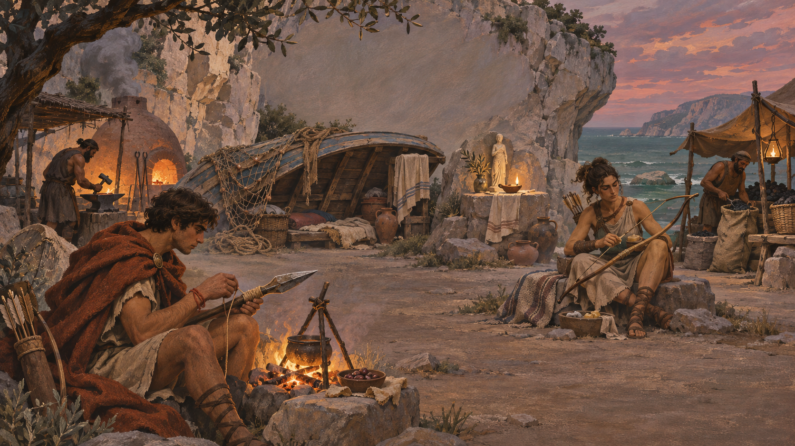

# 《潘多拉之裔》 · PC 主美设定

第一版原创视觉提案。六张设计图分别回答世界的光、人物的形、八章的变化、战斗的读法、营地的距离和动作的重量。它们是下一轮资产制作与评审的起点。实际占地、可达性、阵容、伤害与剧情条件以游戏规则为准。

第一章已定稿的战场比例、原画二维帧流程、地形材质、专招参照与交付样片见[后续章节美术与动画制作指南](27-chapter-art-production.md)。

## 人间有手的痕迹

阿尔卡斯从一座被烧毁的山村出发。玩家第一次认识他，应当看见他用磨毛的红绳重新绑好矛尖。等他走到奥林匹斯，再让同一只手握住宙斯的雷。红绳是贯穿八章的近景道具。

画法采用不透明水粉的成组色面。太阳照到石灰岩时，亮面偏蜜白，背光处混一点蓝灰；薄衣逆光透出铁锈红，青铜只在磨损的棱线上露亮。大笔画山体，小笔留给脸、手和正在交互的物件。凡人身上的缝补随旅程增加，诸神身上的衣褶却次次以同样的角度落下。让两种生命从表面和运动节奏上就有区别。

这张图定光线和初见狮子的心理尺度。关卡实际采用俯视构图，狮子回到规则规定的占地。近景中夸张的比例只用于章节插画和登场镜头。

## 八章的光、空间与玩法

| 章 | 色彩和构图 | 玩家能从画面读出的规则 |
|---|---|---|
| 阿卡迪亚 | 晨光斜切暖白石灰岩。焚村留下黑梁，涅墨亚把黑色收进洞口。 | 台阶的亮边接下一层落脚面。巨石带磨亮的滚动面和地面擦痕，封口后留下断开的滚痕与石屑。 |
| 勒拿 | 铜绿横水，垂直芦苇被蛇颈打断。静水压低亮度，火是战场最小、最亮的点。 | 可再生的断颈是湿亮的开口，烧灼后收缩成哑黑环。玩家能数出还要处理几个伤口。 |
| 斯廷法利斯湖 | 珍珠灰的天水之间，铜鹫翼缘切出一道窄亮线。 | 鸟的影子锚住占格。抬翼预告发射方向，落羽的排列标出弹道。 |
| 克里特 | 暗陶红墙绕黑井逐层回折。转角的红线偶尔露出来。 | 会移动的墙脚有滑槽，启动前先扬尘。敌方冲撞沿槽外的地面单独画危险带。 |
| 爱琴海诸岛 | 白石、群青海面、被石化的人形逆光。海风使布向同一边飘。 | 人像凝固前最后的转头预告危险方向。美杜莎的凝视扇区以边线和刻痕标明朝向。 |
| 冥界 | 靛黑水面吞去远岸，渡船的一枚琥珀灯火定位前后景。 | 亡魂的身体分成错位的两层。安魂时两层合拢，乐句留下的弧线落在受影响格的边界。 |
| 塔尔塔罗斯 | 暗铁锁链斜穿深井，炉缝接近白热。锁环的尺度逐段增大。 | 泰坦各可攻击部位有独立的轮廓缺口；压住的格子出现板岩挤裂纹。受击先动关节，再带动锁链。 |
| 奥林匹斯 | 象牙白柱廊连续重复，天空几乎无阴影。队伍衣上的泥和红绳成了最鲜明的色点。 | 阿瑞斯占用推进轴线，阿波罗占用细直光道，宙斯先在落点画分叉裂缝。三场改变规则时，提示的形状随之改变。 |

## 角色、成长与怪物

首章四者的远读轮廓分别是斜矛、开弓的负空间、低垂的重棒和贴地的鬃块。以角色设定图统一服装与持械。其他图中的披肩色差和简化装备在制作模型时收敛到这张图。赫拉克勒斯初次出场露出肩臂，狮皮留给故事真正获得它的时刻。

| 人物 | 战场上的身份标记 | 一眼能认出的动作 |
|---|---|---|
| 阿尔卡斯 | 红腕绳、偏肩披风、修补的长矛 | 后脚压地，矛尖先定线再出手 |
| 阿塔兰忒 | 紧束短斗篷、长弓的大弧和斜箭袋 | 脚先换位，肩膀保持水平，弓弦贴颊才释放 |
| 赫拉克勒斯 | 裸臂、低重心和单侧拖地的结木棒 | 双手抱石时身体先沉，放手后石头仍滚半拍 |
| 喀戎 | 长躯、横跨马背的药袋、浅披巾 | 前腿折起，俯身把药递到伤者身前 |
| 美狄亚 | 长窄罩衣、垂挂的瓶盏 | 先折断瓶蜡，再沿抛物线洒出火种 |
| 代达罗斯 | 方形工具架、沾灰的厚围裙 | 跪地拉线，机关先展开后锁死 |
| 阿斯忒里俄斯 | 低头形成的角拱，身躯占两格见方 | 蹄子擦地，双肩先后转入冲撞轴 |
| 卡珊德拉 | 遮去半边额头的长巾、空着的双手 | 人群尚未转身，她的视线已经落在下一格 |
| 美杜莎 | 蛇发抱合成一团暗形，面前留一线亮边 | 身体静止，蛇先向目标转头，最后双眼睁开 |
| 彭忒西勒亚 | 骑枪、贴颈的马鬃和前倾上身构成长楔 | 加速时勒低枪尖，冲过目标才起身 |
| 俄耳甫斯 | 手肘与里拉琴框成中空的环 | 按弦的手先停，声音才从近处一圈圈扩开 |

阿尔卡斯的五档神性使用同一套脸和骨架。依次显露腕绳内侧一点余烬、指节细金缝、前臂连成纹、胸口闭合成器壁、强光只从器壁裂口透出。有关希望的真相到第七章才在近景里显形。敌方杂兵按行为家族制作：扑击兽以前肩蓄力，重装者用盾缘显示朝向，远程者在身侧留清楚的拉弦空间。首领再增加一项跨镜头可见的机制标记。

## PC 战斗、动作与反馈

操作镜头采用可整步旋转的正交俯视。默认视野同时容纳接敌双方、两条接近路线和预览落点。岩面上的接缝可以弯曲，战术边线严格吸附规则格。优先级依次为鼠标目标与后果、角色朝向、可操作机关、环境纹理。当前构图示意中额外的人物、旋涡洞口、英文和数值均为排版试画；1-5 实际阵容由关卡载入，普通洞口用自然岩腔和石块表达。

移动预览用连续外缘与路径点，危险区用朝内的三角短刻；推落预览从身体画到最终落脚格，末端用双角括号。悬停显示伤害与击退次序，确认时只保留实际目标和落点。普通走格无需运镜。首领登场可短暂降低视角，归还控制时恢复原朝向。

| 动作 | 预备、接触、收势 | 玩家必须看见 |
|---|---|---|
| 刺击 | 约 160 毫秒收肘，约 80 毫秒送矛，约 180 毫秒撤回；接触时一笔象牙白 | 矛尖抵达身体再出现伤害；擦过和格挡用不同方向的碎屑 |
| 箭击 | 弓弦到颊停一拍，松弦后肩不追箭 | 箭沿实际目标方向运行，受击反馈只在到达时起 |
| 狮扑 | 前掌并拢压低胸口，后腿把身体推出，前掌先着地 | 落地箍在占地边缘；石屑向外，击退箭头继续可见 |
| 无效、破势 | 无效时铜色短屑滑向一侧；破势时支撑脚失稳，护甲接缝张开 | 两种结果即使灰阶观看也能分辨 |
| 神术 | 火沿接触表面爬，毒沿地面聚，雷自落点向外分叉 | 预告停留到确认；多目标特效共享一个起拍，状态标记随后单独保留 |

上述时间为一倍速起始值。命中、封洞与阵亡均由规则事件触发；快进保留接触姿势和终态。关闭震屏后，靠姿势、笔触和地面痕迹传达同样的信息。

## 营地、叙事和菜单

营地镜头降到坐着的人眼高度。锻炉以打铁声和短促火光吸引目光，导师在干燥平地授课，神殿只需石龛和油灯。渡口开放以后，水边多一盏灯和缆绳。鼠标经过时浮出名称；同一功能也有固定文本入口。修矛、缠弓弦、磨药体现关系变化。对白立绘保留手和正在做的事，给简中与英文字幕预留稳定暗底。

标题画面只露出一只破陶罐的内壁与底部一粒暖光。章节路线画在旅行者的布图上，已通过的站点以线结系住。编成页用人物半身像对照地图起始格，点击人物便点亮对应位置。遗物以侧光静物展示材料和损伤，圣物选择页让两件物品等大受光。结算页留下本战最重要的一道痕迹，例如封死的洞口，再列战果。结局沿用营地里的同一盏灯，通过谁伸手添油、是否还有手的温度来回应主角的选择。

界面用炭色薄板、暖白正文和细铜边。标题可用宋体与衬线拉丁字，数值和小字号采用清晰黑体与等宽数字；在中英文最长技能名、最大 UI 缩放与窄窗口分别验排。图标先画实心剪影，再加一道标识切口。技能、状态与材料分别用方框、缺角框与圆形底识别。

## 资产如何成为可玩的画面

以 1920×1080 桌面窗口为第一评审尺寸。第一章横纵格距均为 1.20 个世界单位，角色和敌人使用原尺寸，常规战斗镜头俯角为 45°。地形用可编辑网格组织高差与遮挡，手绘色面纹理固定在物体表面。后续角色动作沿用定稿原画，以二维关键姿势和中间帧绘制各个方向，共用脚底基准和角色色板。逐帧修正脸、手和武器端点。角色描边按邻接明度取色。战术层与文字按窗口分辨率输出。素材尺寸由最靠近的可操作镜头倒推，默认镜头先测试人物高度约 80–110 屏幕像素。需要在实际显示器验证这个范围。

可旋转战场上的房屋、村门、洞穴、巨石与树冠使用有厚度的三维模型。墙角要能露出侧墙，门洞要能透视地面，滚石必须有可辨的轮廓变化。每处新地标至少用相差 90° 的两个游戏镜头评审造型与遮挡。贴地小草和瞬时火焰沿用透明笔触。

首批生产用 1-5 贯穿全链路：一段崖壁、两种洞口状态、可推动巨石、四个单位、移动与落点提示、待机到命中全套、营地对话返回战斗。每类资产保留可编辑源、导出文件以及对应游戏事件。首关成套后，把岩壁断面、步态、受击与界面组件复用到后续章节；每章单独制作自己的地标、首领机制与章节色彩。

评审交付三份实机证据：关闭 HUD 的普通镜头、开启预览的操作镜头、一倍速的完整行动。请初次试玩者指出狮子的头朝哪边、两个洞口哪一个还可通行，以及击退会落到哪一格。记录具体误判，回到造型或提示层修改。当前六张图属于设计阶段；正式图集、可玩画面与这些判断的实测另行验收。
